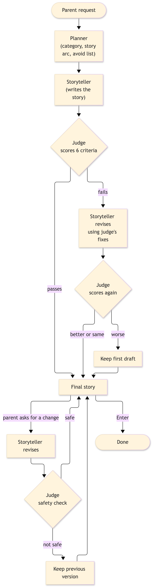

# Bedtime story generator

A small CLI that turns a parent’s request into a child-safe bedtime story: plan → write → judge → optional revision → parent feedback.

## How it works

<div align="center">
  
</div>

1. **Planner** — Picks a category, 5-beat arc, and an **avoid** list (child fears only, plus close relatives like fireflies for “bugs”).
2. **Storyteller** — Writes the story from the plan and category style.
3. **Judge** — Scores six criteria. If the draft fails, the storyteller revises once using the judge’s fixes (with the current draft in context).
4. **Regression guard** — If the revision’s lowest score is worse than the first draft, the first draft is kept.
5. **Parent feedback** — Up to three optional tweaks (e.g. “make it funnier”). Each change is re-judged; only **safety** must stay at or above the pass bar, or the previous version is kept.

## Setup

```bash
python -m venv .venv
source .venv/bin/activate   # Windows: .venv\Scripts\activate
pip install -r requirements.txt
export ANTHROPIC_API_KEY="your-key-here"
```

## Run

```bash
python main.py
```

Press Enter at the prompt to use the built-in Alice and Bob example.

## Files

| File | Role |
|------|------|
| `main.py` | CLI, API calls, pass/revise/feedback logic |
| `prompts.py` | System prompts for planner, storyteller, and judge |
| `diagram.png` | Architecture diagram (above) |

Before submitting the assignment, fill in the “what I’d build next” note at the top of `main.py`.
